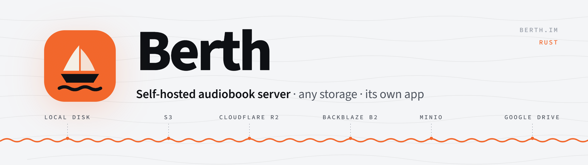

<p align="center">
  <picture>
    <source media="(prefers-color-scheme: dark)" srcset=".github/assets/banner-dark.png">
    
  </picture>
</p>

<p align="center">
  <a href="https://github.com/joveptesg/berth/actions/workflows/ci.yml"></a>
  <a href="LICENSE"></a>
  </p>

<p align="center">
  <b>English</b> · <a href="README.ru.md">Русский</a> · <a href="README.de.md">Deutsch</a> · <a href="README.es.md">Español</a> · <a href="README.fr.md">Français</a> · <a href="README.it.md">Italiano</a> · <a href="README.pt-BR.md">Português (Brasil)</a> · <a href="README.zh-Hans.md">简体中文</a> · <a href="README.ja.md">日本語</a> · <a href="README.ko.md">한국어</a>
</p>

Berth is a self-hosted audiobook server for you and your family. Upload books through the web admin, keep the files on any storage, and listen in the Berth app on Android and iOS.

## Why Berth

- **Database is the source of truth** — books are entities, not scanned folders.
- **Pluggable storage** — local disk, any S3-compatible service (AWS, Cloudflare R2, Backblaze B2, MinIO, Yandex Object Storage), Google Drive.
- **Delivery separated from storage** — the server authorizes, bytes can come straight from object storage or a CDN via short-lived signed URLs.
- **Web admin** for setup, uploads and users; phones connect by QR code.

## Running with Docker

The image `ghcr.io/joveptesg/berth` is built for amd64 and arm64 (Raspberry Pi, ARM NAS).

```sh
mkdir berth && cd berth
curl -fsSLO https://raw.githubusercontent.com/joveptesg/berth/main/docker-compose.yml
docker compose up -d              # http://localhost:8080, data in ./data
docker compose logs berth         # the setup code is in the log
```

Then open the server's address in a browser: `http://<server>:8080`, an IP with a port or the
domain your hosting assigned (e.g. `berth-….sslip.io`). Enter the setup code from the log line
`server is not set up: … enter the setup code K7P2-9QXM`; the code changes on every restart
until setup is done. The address you opened becomes the home or internet address in the phone
QR codes (Settings → Server). If the hosting passes its domain to the container, put it in
`BERTH_WAN_URL` and the log shows a ready link.

`./data` holds the database, its backups, the local storage and `secret.key`.

> [!IMPORTANT]
> Keep a copy of `secret.key` apart from the backups: storage keys in the database cannot be read without it.

### Image tags

| Tag | Follows |
|---|---|
| `1.0.1` | exactly this version, never changes |
| `1.0` | fixes of 1.0 |
| `1` | all 1.x releases (used in `docker-compose.yml`) |
| `latest` | the newest release, including major versions |

To stay on one version, set it in `docker-compose.yml`, e.g. `image: ghcr.io/joveptesg/berth:1.0.1`.
All versions are listed in [Releases](https://github.com/joveptesg/berth/releases).

### Without Compose

For plain Docker or a NAS that asks for an image name (Synology, Unraid, CasaOS):

```sh
docker run -d --name berth --restart unless-stopped \
  -p 8080:8080 -v "$PWD/data:/data" ghcr.io/joveptesg/berth:1
docker logs berth                 # the setup code is in the log
```

In a NAS interface: image `ghcr.io/joveptesg/berth:1`, port `8080`, a folder mounted at `/data`.

To update, run `docker pull ghcr.io/joveptesg/berth:1`, remove the container with `docker rm -f berth`
and start it again with the same `docker run` command; the data stays in `./data`.

### Updating and rolling back

```sh
docker compose pull && docker compose up -d
```

The `1` tag follows the 1.x releases; a new major version needs a change of the tag in
`docker-compose.yml`. Avoid `latest` with auto-updaters such as Watchtower.

Before it changes the database schema, the new version saves a copy to `./data/backups`
(the last 3 are kept; they are also listed under Settings → Backup in the admin). To roll back,
pin the previous version in `docker-compose.yml` (e.g. `image: ghcr.io/joveptesg/berth:1.0.0`)
and restore the copy made before the update:

```sh
docker compose stop berth
docker compose run --rm berth admin restore /data/backups/auto-<time>.sqlite
docker compose up -d
```

### Access from the internet

Berth serves plain HTTP. At home that is enough; for access from outside put a reverse proxy
with HTTPS in front, e.g. [Caddy](https://caddyserver.com) with a `Caddyfile`:

```
books.example.com {
	reverse_proxy localhost:8080
}
```

Then enter `https://books.example.com` in the admin under Settings → Internet address, so the
QR codes for phones include it.

> [!WARNING]
> Keep `./data` on a local disk. SQLite on a network share (NFS, SMB) can corrupt the database.

### Building from source

Uncomment `build: .` in `docker-compose.yml` inside a clone of this repository and run
`docker compose up -d --build`.

### Backups and restore

- Settings → Backup in the admin downloads a copy of the database and restores one: from an
  automatic backup or an uploaded file. The current database is saved to the automatic backups
  first, so a restore can be undone the same way.
- From the console (server stopped): `berth admin restore <file>`.

### Logs

The log records setup, sign-ins (failed ones with the address), phones paired, users,
access and settings changes, uploads and books. Passwords and tokens never go there. Every HTTP
request is logged too with `RUST_LOG=info,tower_http=debug` in the container environment.

## Repository layout

| Path | What it is |
|---|---|
| [`crates/berth-cli`](crates/berth-cli) | `berth` — the server binary |
| [`crates/berth-server`](crates/berth-server) | HTTP server: JSON API v1 and the web admin on axum |
| [`crates/berth-core`](crates/berth-core) | Core domain types |
| [`openapi.json`](openapi.json) | API contract; `cargo test` fails when the API changes |

## Contributing

Contributions are welcome. Read [CONTRIBUTING.md](CONTRIBUTING.md) first: commits are signed off under the DCO and follow Conventional Commits.

## Security

Please do not report vulnerabilities in public issues — see [SECURITY.md](SECURITY.md).

## License

[Apache License 2.0](LICENSE)
